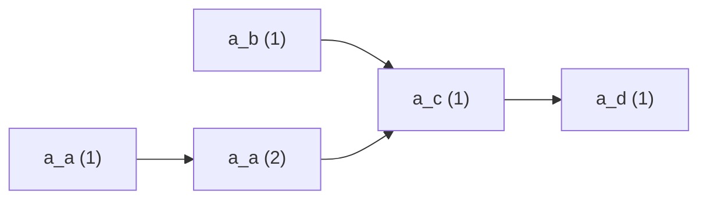
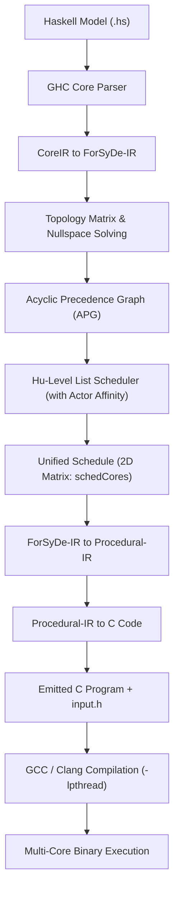

# ForSyDe DevTools: Multi-Core Extension Report

## 1. Executive Summary

The multi-core extension adds periodic parallel execution capabilities to the **ForSyDe DevTools** compiler. It enables Synchronous Dataflow (SDF) models specified in Haskell (`ForSyDe.Shallow`) to be scheduled across multiple processing cores and compiled into high-performance, deterministic C code targeting either **POSIX pthreads (PC)** or the **Raspberry Pi Pico 2 (`pico/multicore.h`)**.

The implementation preserves 100% backward compatibility with single-core execution while introducing:
1. An acyclic precedence graph (APG) constructor with **actor-to-core affinity**.
2. A **Hu-level list scheduler** minimizing critical path makespan.
3. A **unified scheduling abstraction** (`Schedule.hs`).
4. A **polymorphic C buffer architecture** (`buffer_t`) supporting lock-free Single-Producer Single-Consumer (SPSC) queues.
5. A deterministic, headless execution mode using pre-generated `input.h` header files.
6. An automated test harness verifying bit-exact output equivalence across single-core and multi-core executions over 100 iterations.

---

## 2. Theoretical Foundations

### 2.1 Synchronous Dataflow (SDF)
In SDF, a system is a directed graph where nodes are **actors** and edges are **channels (FIFOs)**:
- Each firing of an actor consumes a fixed number of tokens from its input edges and produces a fixed number of tokens on its output edges.
- **Topology Matrix ($\Gamma$)**: An $E \times A$ matrix where $\Gamma_{e, a}$ is the net token balance on edge $e$ produced/consumed by actor $a$.
- **Repetition Vector ($q$)**: The non-trivial integer solution in the nullspace of the topology matrix:
  $$\Gamma \cdot q = \mathbf{0}$$
  Vector $q$ defines how many times each actor must fire during one fundamental schedule period to ensure bounded memory.

### 2.2 Acyclic Precedence Graph (APG)
Within one period, actor $a$ fires $q_a$ times. These individual firings are represented as vertices in an APG:
$$V = \{ (a, j) \mid a \in \text{Actors}, 1 \le j \le q_a \}$$

Edges in the APG represent strict dependencies:
1. **Data Precedence**: If actor $u$ produces tokens consumed by actor $v$, firing $(v, k)$ depends on firing $(u, j)$ whenever:
   $$\text{tokens produced by } (u, 1..j) + \text{initial delays} \ge \text{tokens required by } (v, 1..k)$$
2. **Self-Precedence**: Firing $(a, j+1)$ strictly depends on $(a, j)$. Successive firings of the same actor cannot execute out of order.



### 2.3 Hu-Level List Scheduling
Hu's algorithm schedules ready vertices onto $P$ cores by priority. The priority metric is the **Hu-Level** (the critical path distance from a firing instance to the sink of the APG):
$$\text{HuLevel}(u) = \text{weight}(u) + \max_{(u, v) \in \text{Edges}} \text{HuLevel}(v)$$

At each time step $t$:
- Identify ready vertices (all predecessor instances completed).
- Sort ready instances in descending order of Hu-level.
- Assign the highest-priority instances to available cores.

### 2.4 Actor-to-Core Affinity & SPSC Queues
To avoid costly locking mechanisms and race conditions:
- **Lock-Free Invariant**: Lock-free circular queues (`spsc_queue`) require strictly **Single-Producer Single-Consumer (SPSC)** access.
- **Actor Affinity**: All firings of any given actor $a$ are constrained to run on the **same core**:
  $$\text{Core}((a, 1)) = \text{Core}((a, 2)) = \dots = \text{Core}((a, q_a))$$
- **Result**: Every channel between two actors has at most one producer core and at most one consumer core. Multi-producer or multi-consumer race conditions are eliminated by design without requiring mutexes or semaphores.

---

## 3. Architecture & Implementation

### 3.1 Unified Schedule Abstraction (`src/Schedule.hs`)

Previously, single-core scheduling returned a flat tuple `([IRId], [(IRId, Int)], [(IRId, IRId)])`. To avoid branching logic across the codebase, a unified `ScheduleRecord` was introduced:

```haskell
data Schedule = ScheduleRecord
  { schedStrategy     :: SchedulingStrategy,
    schedCores        :: [[ActorInstance]],      -- 2D Core Matrix (P rows)
    schedBufferSizes  :: [(IRId, Int)],          -- Max observed tokens per edge
    schedDelayBuffers :: [(IRId, IRId)],         -- Initial delay associations
    schedMetrics      :: Maybe ScheduleMetrics   -- Makespan, speedup, work
  }
```

A pattern synonym provides 100% backward compatibility for existing modules:
```haskell
pattern Schedule :: ([IRId], [(IRId, Int)], [(IRId, IRId)]) -> Schedule
pattern Schedule tuple <- (toLegacyTuple -> tuple)
  where
    Schedule (s, b, d) = fromLegacyTuple s b d
```

### 3.2 Polymorphic Buffer Architecture (`include/buffer.h`)

Channels can connect actors residing on the same core (intra-core) or on different cores (inter-core). To allow actor templates to read/write without knowing the underlying buffer type, a tagged union is used:

```c
typedef enum {
    BUFFER_NONBLOCKING,
    BUFFER_BLOCKING
} buffer_type_t;

typedef struct buffer {
    buffer_type_t type;
    union {
        buffer_nonblocking nonblocking;
        buffer_blocking blocking;
    } handle;
} buffer_t;
```

Operations are inlined with zero function-pointer overhead:
```c
static inline void write_token(buffer_t *buf, token data) {
    if (buf->type == BUFFER_NONBLOCKING) {
        write_token_nonblocking(&buf->handle.nonblocking, data);
    } else {
        write_token_blocking(&buf->handle.blocking, data);
    }
}
```

- **Non-blocking buffers**: Lightweight circular array for single-core or intra-core channels.
- **Blocking buffers**: Hardware-assisted lock-free SPSC queue (`spsc_queue`) with spin-pause (`yield` / `_mm_pause` / `tight_loop_contents()`).

### 3.3 Headless Testing with `input.h`

To eliminate terminal I/O deadlock during multi-core execution, inputs are provided via a generated header file:
```c
#ifndef INPUT_H
#define INPUT_H

#define NUM_ITERATIONS 100
#define iteration_max NUM_ITERATIONS

#define RATE_s_in_1 4
static const token input_s_in_1[NUM_ITERATIONS * RATE_s_in_1] = { ... };

#endif
```

---

## 4. End-to-End Compilation Pipeline



### Step 1: Model Ingestion & Core Lowering
The user model is parsed using the GHC API and converted from Core to `ForSyDeIR`:
- Extracts actors, arities (e.g., `actor22SDF`), signals, and initial delay values (`delaySDF`).

### Step 2: Repetition Vector Calculation
Constructs the topology matrix $\Gamma$ and solves for the minimal integer nullspace vector $q$.

### Step 3: APG & Hu-Level Scheduling
- Unrolls firings into instances: $a^1, a^2, \dots, a^{q_a}$.
- Adds data precedence constraints and actor self-precedence.
- Computes Hu-levels from sink vertices backwards.
- Assigns firings to cores using list scheduling while locking each actor's firings to a designated core (`actorAffinity`).

### Step 4: Procedural-IR Lowering
The scheduler output is transformed into procedural constructs:
1. **Worker Functions**: Emits `run_core_c(void *arg)` for each core $c \in [0, P-1]$.
   - Iterates `NUM_ITERATIONS` times.
   - Core firings execute sequentially; inter-core synchronization occurs automatically via blocking buffer reads/writes.
2. **Main Function**:
   - Allocates buffers (`buffer_blocking_new`).
   - Writes initial delay tokens.
   - Launches worker threads (`pthread_create` on PC, `multicore_launch_core1` on Pico 2).
   - Core 0 runs on the main thread; joins other threads upon completion (`pthread_join`).
   - Frees all allocated buffers.

### Step 5: C Code Emission & Input Generation
The compiler writes the C file and creates `input.h` in the output directory (preserving existing data if present).

---

## 5. Verification & Benchmark Results

An automated equivalence test suite (`scripts/compare_schedules.py`) compiles each model to both **sequential C** and **multi-core C**, compiles both with GCC, runs both with **100 iterations of non-repeating random input tokens**, and verifies bit-exact output equivalence.

This test suite is integrated into `stack test` via [`test/ComparisonSpec.hs`](file:///Users/arontiselius/Documents/Embedded_design/forsyde-devtools-extended/test/ComparisonSpec.hs).

### Benchmark Matrix

| Model | Actors | Inputs | Outputs | Topology | Iterations | Result |
| :--- | :---: | :---: | :---: | :--- | :---: | :---: |
| **`SDF_example_008`** | 2 | 2 | 1 | Small, Feedback accumulator loop | 100 | **PASSED** |
| **`SDF_example_002`** | 4 | 2 | 1 | Medium, Multi-rate cross-actor cycle | 100 | **PASSED** |
| **`SDF_example_026`** | 4 | 1 | 1 | Medium, Closed sink-to-source cycle | 100 | **PASSED** |
| **`SDF_example_024`** | 4 | 1 | 3 | Medium, Multi-delay feedforward branches | 100 | **PASSED** |
| **`SDF_example_007`** | 4 | 2 | 1 | Medium, Multi-rate DAG (3- & 4-input actors) | 100 | **PASSED** |
| **`SDF_example_006`** | 5 | 1 | 1 | Medium, Fork-join DAG with 1-to-4 splitter | 100 | **PASSED** |
| **`SDF_example_036`** | 22 | 1 | 1 | Large, 8-channel parallel DSP filterbank | 100 | **PASSED** |
| **`SDF_example_037`** | 38 | 1 | 1 | Very Large, Deep 8-channel DSP pipeline | 100 | **PASSED** |

All 12 test specs in `stack test` pass with **0 failures**.

---

## 6. CLI Usage Quick Reference

```bash
# 1. Compile model to 2-core C code
stack run -- examples/model/SDF_example_002.hs --scheduleStrategy hu-level -c 2 -o build/main.c

# 2. View generated schedule and metrics (critical path, makespan, speedup)
stack run -- examples/model/SDF_example_002.hs --scheduleStrategy hu-level -c 2 -s

# 3. Run full automated test suite (all unit tests + 100-iteration equivalence tests)
stack test

# 4. Run standalone comparison on specific models
python3 scripts/compare_schedules.py --models SDF_example_036.hs SDF_example_037.hs --iterations 100
```
