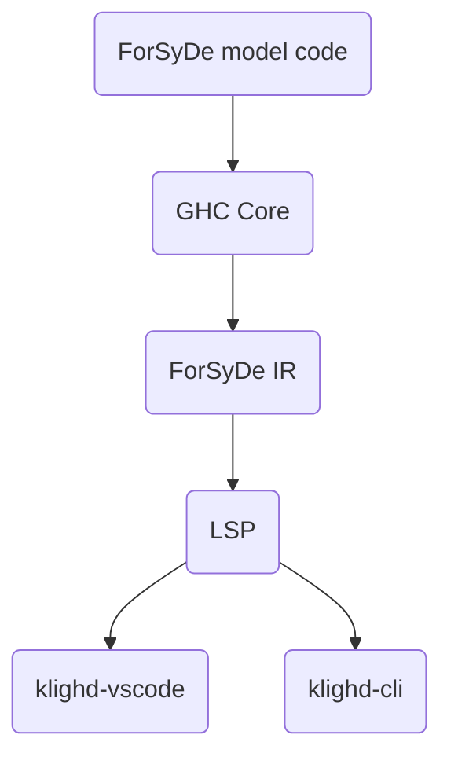

# Visualisation Documentation

## Overview

The ForSyDe visualisation tool uses KIELER diagram technology to graphically visualise ForSyDe models written in Haskell. The specific approach taken is to implement a language server which uses the KIELER diagram server API to communicate with either the KIELER CLI or the KIELER VS Code extension.

The process used is shown in the diagram below. It involves reusing the beginning parts of the compiler. The frontend is used to obtain the ForSyDe IR. The LSP takes the ForSyDe IR which it uses to construct a graph according to the KLighD JSON schema, which KIELER can visualise. This can be communicated to either KLighD VSCode or KLighD CLI. The current local development path has been verified with the KLighD VS Code extension.



### Diagram synthesis module

`src/Visualiser/KLighD.hs` owns the diagram synthesis from ForSyDe IR and an
optional SDF schedule to the KLighD `GraphElement` representation. This keeps
node, port, edge, label, rendering, and layout-property decisions in one
module. `src/LSP/LSP.hs` coordinates requests and sends the resulting graph through
the KLighD protocol.

`forSyDeIRToGraph` uses the default visualiser options;
`forSyDeIRToGraphWithOptions` also accepts the current options. The module
exports `graphElementIdsForNames` to map source names to diagram IDs. Tests
cover graph synthesis, selection IDs, and the diagram options.

### Diagram options

The KLighD Options panel provides three checkboxes, all enabled by default:

| Option | Effect when enabled |
| --- | --- |
| Show firing order | Shows the schedule's actor firing order when scheduling succeeds. |
| Diagram to source | Selecting a diagram element selects its associated source location. |
| Source to diagram | Selecting names in source highlights matching actors or signals in the diagram. |

The schedulability result is not an option: a completed analysis displays
`Schedulable` or `Unschedulable` regardless of whether the firing order is
shown. Hiding the order also leaves the buffer-size analysis available.

The current controls are KLighD **synthesis options** (checkboxes), rather
than one-shot action buttons. `updateOptions` currently sends an empty
`actions` list. Adding a one-shot action would require separately implementing
the relevant KLighD action protocol; the checkbox steps below do not create an
action button.

#### How the options work

1. `src/Visualiser/Options.hs` defines `VisualiserOptions`, its defaults,
   the option metadata sent to KLighD, and `applySynthesisOptions`, which
   reads changed values by ID.
2. `src/LSP/API.hs` stores the options in the language server's `Config`.
   `sendModel` in `src/LSP/LSP.hs` sends them as
   `valuedSynthesisOptions` in an `updateOptions` action via `diagram/accept`.
3. When a checkbox changes, KLighD sends
   `keith/diagramOptions/setSynthesisOptions`. The server applies the values
   only when the notification's URI matches its current model file. The
   current implementation keeps one options record in server configuration;
   it is not a persistent per-document preference store.
4. `Visualiser.KLighD` reads `showFiringOrder` during graph synthesis. A
   change to this option sends a new graph; changing a navigation option does
   not require a graph rebuild. The LSP selection handlers check the other two
   options before sending selection notifications. Disabling source-to-diagram
   also clears the existing diagram selection.

For source-to-diagram selection, the VS Code client sends selected names in a
`forsyde/sourceSelection` notification; the server maps these names to graph
IDs. In the other direction, the server sends `diagram/openInTextEditor` for
the source spans associated with selected diagram elements. Its `forceOpen`
flag allows KLighD to open the source when it cannot match a visible editor.

#### Adding a checkbox

Use an existing option such as `showFiringOrder` as a reference:

1. Add a `Bool` field to `VisualiserOptions` in `src/Visualiser/Options.hs`
   and set its default in `defaultVisualiserOptions`.
2. Add an entry to `valuedSynthesisOptions` with a unique, stable ID (for
   example, `forsyde.showExample`), a label, a description, and the field's
   current value. The existing helper sets `type` to `0` for a checkbox and
   uses the ID as `sourceHash`. Its `initialValue` is currently always `True`;
   update the helper if the new option needs a different initial value.
3. Add a matching ID case in `applySynthesisOptions` to update the field from
   the received Boolean `currentValue`. The ID in this case must match the ID
   advertised in step 2. With KLighD VS Code 0.8.1 the changes are flat entries
   in the `synthesisOptions` array, for example:

   ```json
   {"synthesisOptions": [{"id": "forsyde.showExample", "currentValue": false}]}
   ```

4. Read the option where the behaviour is implemented. For a visual change,
   pass the options to diagram synthesis and make the option-change handler
   call `sendModel` when that value changes. For an interaction, check the
   value in the relevant LSP handler and clear any stale state if needed.
5. Update `test/VisualiserKLighDSpec.hs`: check the default and independent
   updates, then test the option's visible behaviour or selection handling.
   Run `stack test` from the repository root. Finally, build and install the
   server as described in the project setup and verify the checkbox in VS
   Code with the KLighD extension.

## LSP

### LSP Client and Server

LSP consists of 3 parts: the code editor, LSP client, and LSP server.
LSP client in VS Code communicates via JSON RPC, with either stdio/stdin or sockets.

For visualisation purposes, our LSP client also needs to notify the KIELER
extension as in this snippet:

```javascript
// Inform the KLighD extension about the LS client and supported file endings
await vscode.commands.executeCommand<string>(
  "klighd-vscode.setLanguageClient",
  lsClient,
  ["model", "osgiviz"],
);
```

### SKGraphSchema

Currently, the [SKGraphSchema](https://github.com/kieler/klighd-vscode/blob/main/schema/klighd/SKGraphSchema.json)
is implemented by manually defining Haskell data types and defining a JSON serialization
with the package Aeson in `src/SKGraphSchema.hs`.
This approach allows us to leave out properties of the schema which we don't need in the project.

The relevant source for the schema is in [skgraph-model.ts](https://github.com/kieler/klighd-vscode/blob/main/packages/klighd-core/src/skgraph-models.ts) in the KLighD-VSCode repository
and can be used for reference with types not yet added to the schema.

#### Properties

The properties supported by ELK can be found [here](https://eclipse.dev/elk/reference.html).
The values of the properties usually take the form of a list.
We currently haven't added the enum names for the property options, but they are usually numbered
with the first starting at zero.
